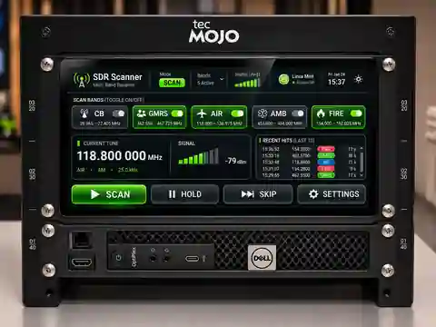

# SDRbox

**SDRbox is a receive-only, spectrum-first radio monitoring appliance.** The goal is to look across usable SDR spectrum windows (roughly 2 MHz each on the current dongle), identify candidate signals above an adaptive noise floor, prioritize useful activity, and demodulate the selected signal. **Not** a conventional frequency-by-frequency scanner as the final architecture.

**Current status — 2026-11-11:** S1 v0.6 spectrum visualization added to GitHub, **awaiting rackio field test**. FastAPI/browser control, local rackio audio, and several GMRS 1–7 receiver prototypes work. The persistent `pyrtlsdr` backend **starts and retunes at approximately three channels/second on rackio** after resolving a library compatibility error. This is still *per-channel retuning*, not wideband FFT discovery. Audio quality and detection performance in the persistent backend have **not yet been separately confirmed**. An FFT-only spectrum view is now implemented; there is **no spectrum-first signal detector or automatic selection**.

## Hardware and UI

- Host: **rackio.local**, Dell OptiPlex 5060 Micro, 8 GB RAM, Linux Mint.
- Receiver: **NooElec NESDR Smart**, RTL2832U/R820T. Future optional SDRplay RSP1A.
- One **1280×400 HDMI-2 touchscreen**, accurate at +0+0. Former upper 1U display removed.
- One FastAPI server, one shared radio, local Chrome and remote LAN browsers on `http://rackio.local:8080`.
- Decoded audio plays on **rackio's speakers**, not over the browser. No kiosk requirement yet.
- Visual reference: approved charcoal/green **single-screen option #2** (illustration, not live screenshot):

## Current software versus target

| Current and verified | Next development direction |
| --- | --- |
| GMRS 1–7 known-channel scanning with live local audio | FFT discovery over one whole ~2 MHz usable window |
| Python/rtl_fm scanner: ~1 channel/s, correct displayed channels, activity, auto-resume | Adaptive local noise floor, candidate peak extraction and validation |
| Persistent single-open SDR: ~3 channel retunes/s (startup/retune verified) | Detect all simultaneous signals in a captured window, rather than retuning each channel |
| Web controls, shared backend, simulation and legacy fallback | Strongest qualified signal first; configurable priority later |
| Local NFM prototype | AM airband and multiple overlapping windows/banks after GMRS proof |

**A window is not guaranteed to have exactly 2.0 MHz of clean usable bandwidth.** Calibrate sample rate, overlap, center DC artifacts and edge performance on the actual NESDR. A single tuner cannot continuously observe separated 462 MHz and 467 MHz groups at once.

## Start here

- [HANDOFF.md](HANDOFF.md) — short, authoritative state and next task
- [DEVELOPMENT.md](DEVELOPMENT.md) — field results and upcoming milestones
- [ARCHITECTURE.md](ARCHITECTURE.md) — target wideband algorithm and component boundaries
- [REQUIREMENTS.md](REQUIREMENTS.md) — testable acceptance criteria
- [RUNNING.md](RUNNING.md) — today's working code and commands
- [HARDWARE.md](HARDWARE.md) / [TOUCHSCREEN.md](TOUCHSCREEN.md) — verified physical setup
- [WEB_API.md](WEB_API.md) / [UI.md](UI.md) — actual interfaces and future presentation

**Development rule:** Make changes in small, user-tested increments; preserve at least one working `rtl_fm` fallback. No new code for the spectrum-first design until implementation is explicitly requested. LAN-only prototype; **do not expose its unauthenticated API to the Internet**.
