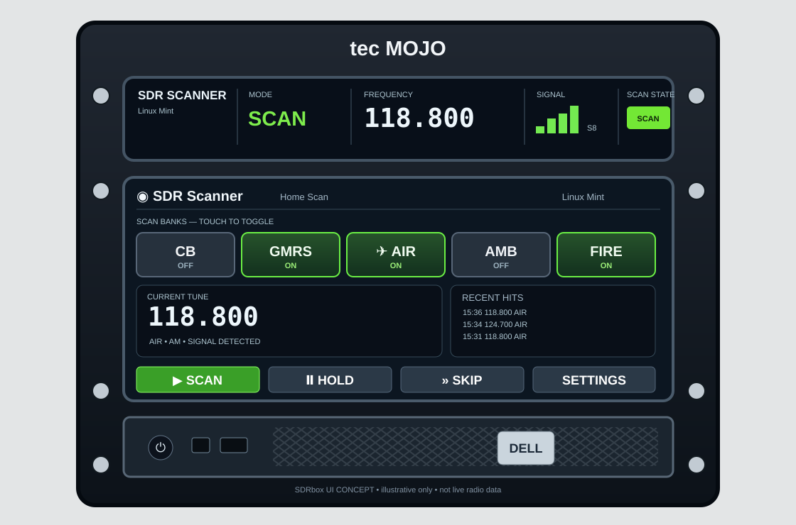

# UI design and approved mockup

_Last reviewed: 2026-11-07._

## Design decision

The user **approved the first mockup**, then specifically requested the same first mockup **with the external antenna and visible SDR equipment removed**. It shows a polished dark, green-accented scanner appliance mounted in the real-style rack, not a general-purpose SDR workstation.



**Image provenance:** This SVG is a simplified repository-native layout representation. The approved high-resolution photorealistic concept is a generated PNG from the conversation, **not yet committed here as a binary image**. Add the exported image to `assets/scanner-appliance-mockup.png` when available and change the image reference if preferred. Don't claim this vector is the exact approved PNG.

## Confirmed physical display geometry

| Panel | Native resolution | Approximate aspect ratio | UI responsibility |
| --- | --- | --- | --- |
| **Upper 1U** | **1424 × 280 px** | **5.09:1** | Permanent, read-only scanning status |
| **Lower 2U** | **1280 × 400 px** | **3.20:1** | Touch-first home controls, banks, recent hits |

These pixel dimensions are **user-confirmed**. The display mapping is now confirmed: **HDMI-1 top (+0+0), HDMI-2 lower (+59+280)**. Upper touch is disabled and lower touch has been confirmed accurate after `xinput map-to-output ... HDMI-2`; see [TOUCHSCREEN.md](TOUCHSCREEN.md) for stable USB path handling and proposed login autostart (**not yet verified after reboot**). The reference concept art is *not* pixel-accurate; implement to these real window sizes.

## Web views, not native Qt windows

**Decision:** all three views are delivered by the same **rackio FastAPI web server** as HTML/CSS/JavaScript pages, not PySide6. On the rack, Chromium runs two independent fullscreen/app-style browser windows:

- **`/status`** on **HDMI-1**, upper **1424×280**: read-only, no touchscreen.
- **`/control`** on **HDMI-2**, lower **1280×400**: touch-enabled.
- **`/`** in a browser anywhere on the home LAN: responsive controls + status (desktop, tablet or phone). Same app, not a separate implementation.

Use shared frontend CSS/components/state utilities with distinct page layouts. Avoid trying to squeeze the entire 1280×400 design into the upper strip; CSS Grid/Flexbox is appropriate. Observe actual viewport, browser scaling and system DPI; verify Chromium window geometry on Linux Mint before implementing kiosk autostart. **Touchscreen USB mapping is already tested**, but browser kiosk placement and session autostart are not yet tested.

The backend is the **single source of truth** for current bank selection, scanner state and signal data. Live updates via WebSocket; full state refresh on connect/reconnect; browsers continue to show connection status when the server drops. Controls should not falsely imply the SDR has accepted an action until status confirms it.

Audio is **local on rackio for v1** (no browser stream); add a browser audio output feature in a later phase. All remote clients may control the one scanner, subject to network access policy. No simultaneous independent tuning with one NESDR.

## Physical display split

### Top: 1U / status window

Persistent, glanceable and read-only in normal use:
- SDR Scanner identity / compact icon
- SCAN / RECEIVING / HOLD / ERROR
- current **frequency** displayed prominently
- relative signal meter and (if genuinely calibrated) dBm; otherwise show relative units
- active bank and modulation if space permits

No system menus or Linux desktop widgets in appliance view.

### Middle: 2U / touch controls

**First screen (primary):**

- Header: SDR Scanner — Home Scan.
- Large toggle tiles: **CB**, **GMRS**, **AIR**, **AMB**, **FIRE**; green indicates included in scan rotation, grey indicates disabled. These are **independent toggles**, not a one-at-a-time radio-group selector.
- Center: current frequency, bank, modulation, signal indication.
- Right: recent hits (time, frequency, bank, duration).
- Bottom: **SCAN**, **HOLD**, **SKIP**, **SETTINGS**.

**Secondary screens (not all at once):** bank editor, per-bank chunk list, channel inclusion/exclusion, threshold/dwell/resume settings, audio, and eventual advanced spectrum view.

## Interaction semantics

- Toggle a bank on/off even while scanning; scheduler rebuilds safely at next boundary.
- SCAN starts/resumes. If no banks are selected, show a clear instruction.
- HOLD freezes listening; distinguish manually held from a voice-triggered auto pause.
- SKIP advances from a live hit. Use a short cooldown before revisiting the same signal.
- Recent-hit tap selects/holds that frequency as a future enhancement; in v1 it's okay to display only.
- The display must still be usable if a physical antenna rod momentarily obscures it during bench testing, but the permanent plan is a remote antenna.

## Theme and implementation

Use **HTML5/CSS/JavaScript** with modern CSS Grid/Flexbox and reusable state/presentation modules; do **not** create a PySide6 GUI. Target exact **1424×280** upper and **1280×400** lower physical screen viewports. Dark charcoal, readable off-white typography, selective vivid green for active toggle/scan state.

The lower 1280×400 **single-screen Home view** should fit a shallow header, one row of five bank toggles, current-frequency/signal and recent hits, plus bottom SCAN/HOLD/SKIP/SETTINGS buttons **without vertical scrolling**. Advanced options use separate screens/pages. The upper 1424×280 panel uses large read-only glanceable typography and no interactive controls. The remote `/` page rearranges the same control/status components responsively. Status remains grounded in real receiver events, never fake signal strength or recent hits.

Design UI using **simulated events initially** if helpful, but clearly label demo/simulation mode and do not count it as working SDR reception. Test tap targets and browser zoom/DPI on physical panels.

## Mockup asset handling

An exact high-resolution, antenna-free PNG was generated in the conversation. The user can save it locally and add to this repo as `assets/scanner-appliance-mockup.png`:

```bash
mkdir -p assets
cp /path/to/downloaded/polished_rack_mounted_sdr_scanner.png assets/scanner-appliance-mockup.png
git add assets/scanner-appliance-mockup.png
git commit -m "docs: add approved scanner-appliance mockup"
git push
```

The PNG is **concept art** with illustrative frequencies, UI values, date, and recent-hit rows; these are not measured scan results, nor validated local CB/FIRE/AMB band assignments.
